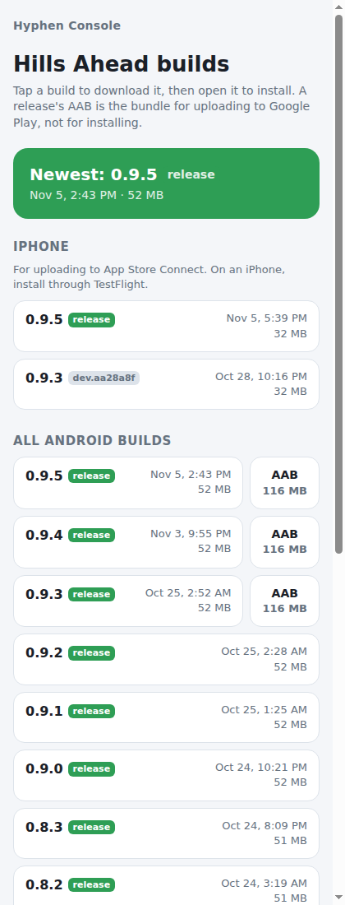

# Hyphen Console

A small self-hosted console for an indie developer with apps on the App Store and Google Play. It runs on a home server and is reachable only from the home network and a Tailscale tailnet.

**Today:**
- One download page per app for test builds (Android APKs with their Play bundles, and iOS IPAs), so a phone can install the latest build straight from the NAS.
- Health checks on each app's backend, with uptime history and an email when something goes down and when it recovers.
- Reviews from the App Store and Google Play, kept over time, with an email when new ones arrive.
- Vitals: Google Play's crash and ANR rates against Play's bad-behavior thresholds (with an email if an app crosses one), and App Store crashes per 1,000 sessions.
- A weekly digest email with all of the above for every app, listing what needs a look first. See [Roadmap](#roadmap).



## Design

- **No runtime dependencies.** Node 24 runs the TypeScript directly (type stripping). The server uses only Node built-ins: `node:http`, `node:fs`, `node:sqlite` for history, and `node:crypto` to sign the JWTs the store APIs require (ES256 for Apple, RS256 for Google). `typescript` and `@types/node` are dev-only, for type checking.
- **Configuration lives outside the repo.** Machine-specific settings go in `.env` and `config/apps.json`, and git ignores both. The committed `.env.example` and `config/apps.example.json` hold only placeholders. API keys for later phases will go in `secrets/`, which git also ignores.
- **Private by default.** The server refuses any client outside an allowlist of CIDRs: private LAN ranges, Docker's bridge, loopback and Tailscale. Override it with `ALLOWED_CIDRS`. It answers only `GET` and `HEAD`.
- **Serves build files only.** File URLs must name a build of that app (`<prefix>-<x.y.z>….apk|aab|ipa`, or its `.sha256`). Other files in the folder, paths and dot files are never served. Downloads support byte ranges, so a phone can resume a large APK.
- **Locked-down container.** No Linux capabilities, `no-new-privileges`, a read-only root filesystem, and read-only mounts apart from `data/`. It runs as the unprivileged `node` user unless `CONTAINER_USER` says otherwise.
- **Alerts that don't cry wolf.** A check counts as down only after `CHECK_FAIL_THRESHOLD` failures in a row (2 by default), and an outage sends exactly one "down" email and one "recovered" email.
- **Strict headers.** A same-origin Content Security Policy (the page's script and styles are separate files, not inline), plus `nosniff`, `no-referrer` and frame denial.
- **CI** type-checks, runs the tests, builds the image, and runs [gitleaks](https://github.com/gitleaks/gitleaks) over the full history.

## Setup

```bash
cp .env.example .env                           # set BUILDS_ROOT, PORT
cp config/apps.example.json config/apps.json   # list your apps
mkdir -p data secrets                          # data/ must be writable by CONTAINER_USER
docker compose up -d --build
```

Builds go in `<BUILDS_ROOT>/<app id>/`, named `<filePrefix>-<version>[-<extra>][-<abi>].<apk|aab|ipa>`:

| File | Shown as |
|---|---|
| `my-app-1.2.0-arm64.apk` | release 1.2.0 |
| `my-app-1.2.0.aab` | the Play bundle, beside the 1.2.0 APK |
| `my-app-1.2.0-dev.a1b2c3d-arm64.apk` | dev build of 1.2.0, tagged `dev.a1b2c3d` |
| `my-app-1.2.0.ipa` | iOS release 1.2.0 |

Copy builds in under a temporary dot-file name and rename them when the copy finishes, so the page never lists a half-copied file. A `<file>.sha256` beside a build is linked from the API.

Open `http://<server>:<PORT>/` for the app list, or `/apps/<id>` for one app's status and builds.

### Health checks

List them per app in `config/apps.json`:

```json
"health": [
  { "name": "API", "url": "https://api.example.com/health" },
  { "name": "Proxy", "url": "https://proxy.example.com/", "expectStatus": 401 }
]
```

By default a check passes on any 2xx. `expectStatus` names one exact status instead. For an API that needs a key, expect its 401: the check still proves the service answers, and it costs nothing upstream. Redirects aren't followed. Results are kept for 90 days.

### Alert email

Alerts go out through [Cloudflare Email Sending](https://developers.cloudflare.com/email-service/). Until that's set up, they're written to the container log.

1. Onboard the sending domain in the Cloudflare dashboard (Email Service → Email Sending), or with `wrangler email sending enable <domain>`.
2. Create an API token with the Email Sending permission, and save it in `secrets/cloudflare-email-token`. git ignores that folder, and it's mounted read-only. The file must be readable by `CONTAINER_USER`. With `CONTAINER_USER=0` the container has no capabilities, so root can't bypass file permissions: make the file owned by root (mode `640`) and the folder `711`.
3. Set `ALERT_EMAIL_TO`, `ALERT_EMAIL_FROM` (an address on the onboarded domain) and `CLOUDFLARE_ACCOUNT_ID` in `.env`, then restart.
4. Send a test: `docker exec hyphen-console node src/cli.ts test-email`.

`docker exec hyphen-console node src/cli.ts check` runs every health check once and prints the results.

### Reviews

Each store is used once its credentials are in `secrets/`. Apps are matched by `ios.bundleId` (or `ios.appStoreId`) and `android.package` in `config/apps.json`.

**App Store Connect:** in App Store Connect, go to Users and Access → Integrations → App Store Connect API → Team Keys and generate a key with the **Customer Support** role. Save the `.p8` file as `secrets/app-store-connect.p8`, and set `APP_STORE_CONNECT_KEY_ID` and `APP_STORE_CONNECT_ISSUER_ID` in `.env`. Requests are signed with a short-lived ES256 JWT.

**Google Play:** in a Google Cloud project, enable the Google Play Android Developer API and create a service account with a JSON key. Save the key as `secrets/google-play-service-account.json`. Then invite the service account's email in Play Console (Users and permissions), with **Reply to reviews** and **View app information** permissions for the app. Google's API only returns reviews with written comments, created or edited in the last 7 days, for production releases. That's why the console fetches every hour and keeps everything it sees.

The first successful fetch from each store only fills the history, so no email goes out for old reviews. After that, new and edited reviews are emailed in one message per fetch, and 1–2 star reviews are flagged in the subject. Set `REVIEW_EMAILS=low` to get only those, or `off` for none.

`docker exec hyphen-console node src/cli.ts reviews` tests the credentials: it fetches one page from each store and saves nothing.

### Vitals

**Google Play:** the service account from Reviews, with the **Google Play Developer Reporting API** also enabled in its Cloud project. The console reads the daily user-perceived crash and ANR rates for the last 30 days. It sends an email when either 28-day rate crosses Play's bad-behavior threshold (1.09% for crashes, 0.47% for ANRs), and another when it's back under.

**App Store:** Apple doesn't answer queries. It generates reports daily once an *ongoing report request* exists for the app. Reading those reports needs a team key with the **Finance** role: save it as `secrets/app-store-connect-finance.p8` and set `APP_STORE_CONNECT_FINANCE_KEY_ID`. Only an **Admin** key can start the request, so do that once with a temporary Admin key, then revoke it:

```bash
docker exec hyphen-console node src/cli.ts apple-report-request <admin key id> /secrets/<admin key>.p8
```

The first reports arrive 1–2 days later. The console sums the **App Crashes** and **App Sessions** reports per day (late data is added to the day it belongs to, and each report instance is counted once) and shows crashes per 1,000 sessions. Apple only counts people who share analytics with developers.

`docker exec hyphen-console node src/cli.ts vitals` checks both stores' access and saves nothing.

### Weekly digest

One plain-text email a week, on `DIGEST_DAY` at `DIGEST_HOUR` in `TZ` (Monday at 8:00 by default). It opens with anything that needs a look: an outage, a check that's still down, a 1–2 star review, a Play rate over its limit, or a store that stopped answering. Then each app gets:

- **Uptime:** each check's uptime for the week, the number of outages and the longest one
- **Reviews:** new reviews by store and their average rating, low ratings quoted (with how many have no reply yet), and all-time averages
- **Vitals:** Play's 28-day crash and ANR rates against their limits, with the change from a week earlier; App Store crashes per 1,000 sessions against the week before
- **Builds:** builds published that week

The server checks every 15 minutes whether the digest is due and remembers the day it last sent one, so a restart neither skips nor repeats it. `docker exec hyphen-console node src/cli.ts digest` prints this week's digest, and `--send` emails it now.

### Settings

| Variable | Default | Meaning |
|---|---|---|
| `PORT` | `8095` | Host port |
| `BIND_IP` | `0.0.0.0` | Host address to listen on |
| `BUILDS_ROOT` | — | Host folder with one subfolder per app (required) |
| `ALLOWED_CIDRS` | private ranges, loopback, Tailscale | Comma-separated client allowlist |
| `CONTAINER_USER` | `node` | Set `0` for NFS exports that refuse container uids (the container stays capability-free and read-only) |
| `TZ` | `UTC` | Time zone for alert-email times and the digest schedule |
| `CONSOLE_URL` | — | This console's address, for links in alert emails |
| `CHECK_INTERVAL_SECONDS` | `120` | Time between health-check rounds (minimum 30) |
| `CHECK_FAIL_THRESHOLD` | `2` | Failures in a row before a check counts as down |
| `ALERT_EMAIL_TO` | — | Alert recipient. Empty means alerts are only logged |
| `ALERT_EMAIL_FROM` | — | Sender, on a domain onboarded to Cloudflare Email Sending |
| `CLOUDFLARE_ACCOUNT_ID` | — | The Cloudflare account that sends |
| `REVIEW_SYNC_MINUTES` | `60` | Time between review fetches (minimum 15) |
| `REVIEW_EMAILS` | `all` | Which new reviews to email: `all`, `low` (1–2 stars) or `off` |
| `APP_STORE_CONNECT_KEY_ID` | — | App Store Connect API key ID |
| `APP_STORE_CONNECT_ISSUER_ID` | — | App Store Connect issuer ID |
| `APP_STORE_CONNECT_FINANCE_KEY_ID` | — | Key ID of the Finance-role key used for analytics reports |
| `VITALS_SYNC_HOURS` | `6` | Time between vitals fetches |
| `DIGEST` | `on` | `off` stops the weekly digest |
| `DIGEST_DAY` | `monday` | Day the digest goes out |
| `DIGEST_HOUR` | `8` | Hour (0–23, in `TZ`) the digest goes out |

## API

| Route | Returns |
|---|---|
| `GET /api/apps` | `[{ id, name }]` |
| `GET /api/status` | Every health check: up or down, since when, the last result, and 24-hour and 7-day uptime |
| `GET /api/apps/<id>/reviews` | `{ summary, sync, reviews }`: rating per store, last fetch per store, newest 50 reviews |
| `GET /api/apps/<id>/vitals` | `{ google, apple }`: Play's 28-day rates, thresholds and daily series; App Store crashes and sessions |
| `GET /api/apps/<id>/builds` | `{ app, android: Build[], ios: Build[] }`, newest first |
| `GET /files/<id>/<file>` | The build file, with range support |
| `GET /healthz` | `ok` |

## Development

```bash
npm install
npm run check                          # typecheck + tests
CONFIG_FILE=config/apps.json BUILDS_ROOT=/path/to/builds PORT=8096 npm run dev
```

## Roadmap

1. ~~Multi-app builds page~~
2. ~~Health checks for each app's backend, with email alerts~~
3. ~~Reviews from both stores, kept over time~~
4. ~~Crash and ANR rates (Play Developer Reporting API), crashes and sessions (App Store Connect Analytics Reports API)~~
5. ~~A weekly digest~~

## License

[MIT](LICENSE)
